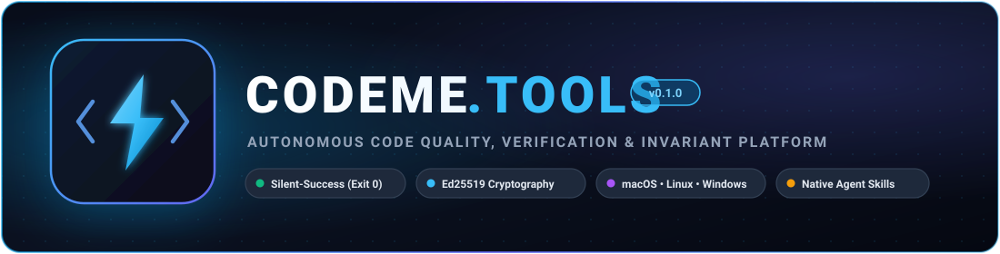
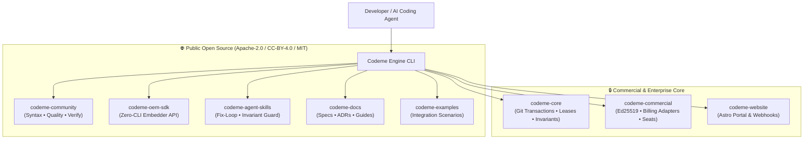

<div align="center">



<br/><br/>

[](https://github.com/CodeMe-Tools)
[](https://opensource.org/licenses/Apache-2.0)
[](https://codeme.tools/download)
[-0ea5e9.svg?style=for-the-badge&logo=speedtest&logoColor=white)](https://codeme.tools)
[](https://codeme.tools)

<br/>

**Codeme** is the next-generation autonomous code quality, verification, and invariant enforcement platform built for software engineering teams and autonomous AI coding agents.

[Website](https://codeme.tools) • [Documentation](https://github.com/CodeMe-Tools/codeme-docs) • [Community Core](https://github.com/CodeMe-Tools/codeme-community) • [OEM SDK](https://github.com/CodeMe-Tools/codeme-oem-sdk) • [Agent Skills](https://github.com/CodeMe-Tools/codeme-agent-skills)

---

</div>

## ⚡ Core Philosophy & Architecture

Codeme guarantees deterministic, friction-free verification through four core pillars:

1. **Deterministic Local Execution (Silent-Success Contract):**
   - On success: clean `exit 0` with **zero bytes** written to stdout/stderr — preserving context windows and token budgets for autonomous coding agents.
   - On violation: structured, machine-actionable SARIF v2.1.0 and JSON diagnostics with precise line, column, and remediation instructions.
2. **Cryptographic Ed25519 Licensing & Offline Operation:**
   - RFC 8785 canonical JSON tickets signed with Ed25519 root keys.
   - Guaranteed 30-day offline allowance with grace periods; air-gapped perpetual validation for mission-critical enterprise deployments. Zero mandatory network check-ins.
3. **Strict Repository Boundaries & Multi-Agent Concurrency:**
   - SQLite WAL file-leasing engine preventing race conditions during concurrent multi-agent repair loops.
   - Automated git transaction isolation and temporary worktree sandboxes with non-destructive rollbacks.
4. **Universal Cross-Platform Toolchain:**
   - Native single-binary delivery across macOS (Apple Silicon & Intel x86_64), Linux (Ubuntu priority, Debian, Alpine/musl), and Windows (x64) with dual-standard SBOMs (CycloneDX v1.5 & SPDX v2.3).

---

## 🏛️ Repository Ecosystem



### 🌐 Public Repositories

| Repository | Purpose | License |
|---|---|---|
| [**`codeme-community`**](https://github.com/CodeMe-Tools/codeme-community) | Open-source core: AST syntax repairs, DDD quality linting, and targeted test verification engines. | Apache 2.0 |
| [**`codeme-oem-sdk`**](https://github.com/CodeMe-Tools/codeme-oem-sdk) | High-performance embedding SDK (Python & TypeScript) with schema-validated JSON contracts and token savings accounting. | Apache 2.0 |
| [**`codeme-agent-skills`**](https://github.com/CodeMe-Tools/codeme-agent-skills) | Native agent skills (`fix-loop`, `invariant-guard`, `repository-router`, `release-guard`) — zero MCP server overhead. | Apache 2.0 |
| [**`codeme-docs`**](https://github.com/CodeMe-Tools/codeme-docs) | Authoritative manuals, Architecture Decision Records (ADRs 0001–0009), and documentation synchronization tooling. | CC-BY-4.0 |
| [**`codeme-examples`**](https://github.com/CodeMe-Tools/codeme-examples) | Integration examples, autonomous review bot embeddings, and fault-injection suites across Python, TypeScript, and Swift. | MIT |
| [**`.github`**](https://github.com/CodeMe-Tools/.github) | Organization health, reusable CI verification gate workflows, and issue/PR templates. | Apache 2.0 |

### 🔒 Enterprise & Commercial Repositories

| Repository | Purpose | License |
|---|---|---|
| **`codeme-core`** | Proprietary execution core, isolated Git transactions, SQLite multi-agent lease manager, state invariants, and native packager. | Commercial |
| **`codeme-commercial`** | Ed25519 cryptographic entitlement issuer, Merchant of Record (Polar & Lemon Squeezy) webhook ingestion, and team seat leasing. | Commercial |
| **`codeme-website`** | Production Astro portal, subgrid pricing matrix, documentation search, and commercial customer license dashboard. | Commercial |

---

## 🚀 Quick Start

### Installation

```bash
# macOS (Homebrew or direct binary)
curl -fsSL https://codeme.tools/install.sh | bash

# Linux (Debian / Ubuntu / Alpine)
curl -fsSL https://codeme.tools/install-linux.sh | sh

# Windows (PowerShell)
irm https://codeme.tools/install.ps1 | iex
```

### Basic Usage

```bash
# Verify syntax, code quality, and test invariants silently
codeme verify .

# Run continuous autonomous fix loop
codeme fix --safe --rollback-on-failure

# Inspect cryptographic license status
codeme license status
```

---

<div align="center">
  <sub>Built with precision by the <strong>CodeMe Team</strong> • <a href="https://codeme.tools">codeme.tools</a></sub>
</div>
